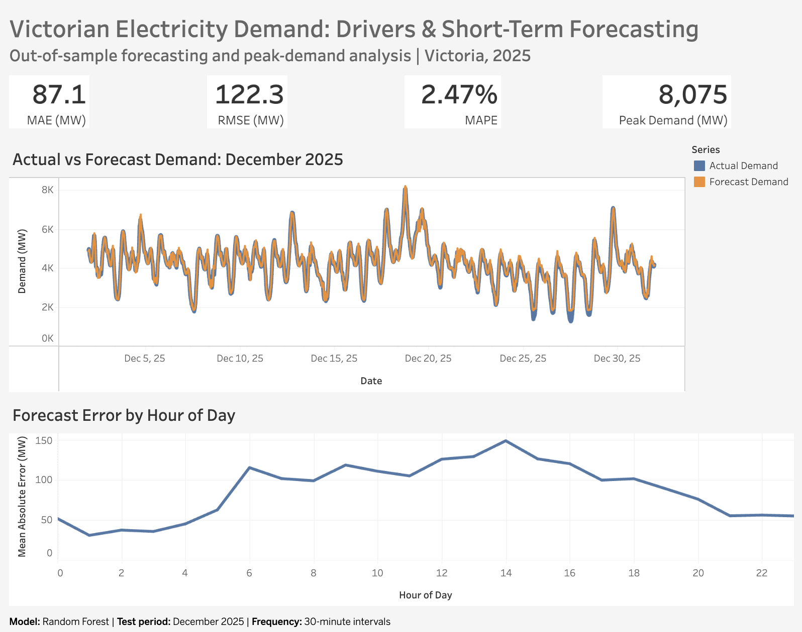

# Victorian Electricity Demand Forecasting

This project analyses Victorian electricity demand during 2025 and builds a machine-learning model to forecast short-term demand using historical electricity demand, weather and calendar information.

The model was trained using earlier observations and tested on an unseen December 2025 holdout period. Its forecasts were compared with a simple baseline that assumes near-term demand will remain similar to its most recently observed level.

## Results

The final Random Forest model was evaluated on December 2025:

| Metric | Random Forest | 30-min Persistence |
|---|---:|---:|
| MAE | 87.1 MW | 145.0 MW |
| RMSE | 122.3 MW | 184.3 MW |
| MAPE | 2.47% | 3.69% |

The Random Forest reduced MAE by approximately 40% relative to the 30-minute persistence baseline.

During the highest 5% of demand observations, MAE was 120.5 MW compared with 209.0 MW for the persistence baseline.

Peak observed demand during the test period was approximately **8,075 MW**.


## Why this matters

Electricity demand changes significantly throughout the day and can rise sharply during periods of high usage. Being able to anticipate these changes helps electricity system operators and energy businesses plan for how much electricity will be required in the near term.

In this project, historical demand, weather and calendar patterns were used to predict short-term electricity demand. The model was trained on earlier observations and evaluated on an unseen December 2025 holdout period, simulating how a forecasting model would perform on future demand.

More accurate short-term forecasts can support decisions such as:

- preparing for periods of unusually high electricity demand
- improving generation and operational planning
- identifying when forecast uncertainty is greatest
- reducing the risk of over- or under-preparing for expected demand

The model reduced MAE by approximately 40% compared with a simple persistence forecast, showing that combining recent demand with weather and time-based information provided useful predictive information beyond assuming demand would remain near its most recent level.


## Dashboard

An interactive Tableau dashboard summarises forecast performance, actual vs predicted demand and how forecast error changes throughout the day.

**Tableau Public:** [View dashboard](https://public.tableau.com/app/profile/mani.jabbari/viz/VictorianElectricityDemandDriversShort-TermForecasting/Dashboard1)



## Approach

The analysis combines Victorian electricity demand with weather and calendar information. Features used for forecasting include:

- recent electricity demand lags
- rolling demand
- temperature and apparent temperature
- humidity, wind speed and precipitation
- hour, day of week and month
- weekend and holiday indicators

A chronological train/test split was used rather than a random split to avoid using future observations to predict the past.

The Random Forest was compared against simple persistence baselines before being evaluated on the December 2025 holdout period.

## Key findings

- Recent demand is by far the strongest predictor of short-term electricity demand.
- The Random Forest substantially outperformed the persistence baseline on the holdout period.
- Forecast errors were generally larger during daytime hours than overnight.
- The model maintained relatively strong accuracy during peak-demand periods, where forecasting errors are potentially more consequential.

## Repository

```text
data/           Raw and processed data
notebooks/      Data preparation, analysis and modelling
outputs/        Figures and dashboard data
src/            Supporting project code